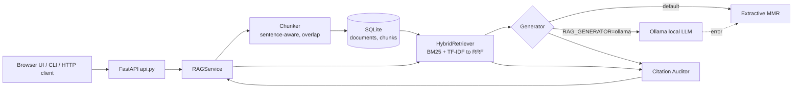

# Grounded RAG Citation Auditor

Retrieval-augmented question answering where **every sentence of the answer is verified against the source it cites**. It catches the failure modes that make RAG systems untrustworthy in production: invented numbers, flipped negations, citations that point at the wrong source, and claims with no citation at all.

Runs fully offline at zero cost. You can plug in a local LLM through [Ollama](https://ollama.com) if you want one.

## Problem

RAG answers *look* grounded because they carry `[1]`-style citations, but LLMs regularly:

- cite a source that doesn't contain the claim,
- change a number (`24 months` → `36 months`),
- invert meaning (`does not cover` → `covers`),
- mix cited facts with uncited ones.

Most demos never check any of this. Users can't tell a grounded answer from a confident hallucination.

## Solution

A small, dependency-light pipeline:

1. **Ingest** documents → sentence-aware chunks with overlap → SQLite.
2. **Retrieve** with a hybrid lexical retriever: BM25 and TF-IDF cosine, fused by **Reciprocal Rank Fusion**.
3. **Generate** an answer with numbered citations, using either
   - `extractive-mmr` (default, offline), which picks relevant, non-redundant source sentences via Maximal Marginal Relevance, or
   - `ollama:<model>`, any local LLM, prompted to cite every sentence (it falls back to extractive if Ollama is unreachable).
4. **Audit** each claim against its cited evidence and return a structured report.

## Features

| Area | What it does |
|---|---|
| Claim audit | Per-sentence verdict: `supported`, `partially_supported`, `unsupported`, `misattributed`, `uncited`, `non_claim` |
| Hallucination checks | Numeric consistency, negation polarity, token recall, ROUGE-L recall vs the best evidence sentence |
| Citation repair | Suggests the correct source for misattributed or uncited claims |
| Scores | `groundedness` (0–1), `citation_accuracy`, overall label `grounded / partially_grounded / ungrounded / abstained` |
| Abstention | Detects "I could not find…" answers instead of scoring them as failures |
| Bring-your-own answer | `POST /audit` audits *any* model's answer against sources you supply |
| Ingestion | JSON or file upload (`.txt`, `.md`), SHA-256 deduplication, 2 MB limit |
| UI | Single-page web UI with colour-coded claim verdicts and retrieval scores |
| Ops | Dockerfile with healthcheck, GitHub Actions CI (3 Python versions + Docker build), structured logging |

## Architecture



**Audit scoring** for a claim *c* against evidence *e*:

```
score = max( 0.6·recall(c,e_sent) + 0.4·ROUGE-L(c,e_sent),  0.85·recall(c,e_chunk) )
if numbers(c) ⊄ numbers(e):   score = min(score, 0.30)
if negation(c) ≠ negation(e): score = score × 0.5
supported ≥ 0.70 > partially_supported ≥ 0.40 > unsupported
```

If a claim scores as unsupported against its cited source but ≥ 0.70 against another retrieved source, it is labelled `misattributed` and the correct source is suggested.

### Database design

```
documents(id PK, title, source, sha256 UNIQUE, created_at)
chunks(id PK, document_id FK→documents ON DELETE CASCADE, ord, text, UNIQUE(document_id, ord))
```

## Tech stack

Python 3.10+, FastAPI, Pydantic v2, SQLite, httpx, vanilla JS/HTML, pytest, Docker, GitHub Actions. Optional: Ollama for a local LLM.

## Setup

```bash
python -m venv .venv
source .venv/bin/activate        # Windows: .venv\Scripts\activate
pip install -e ".[dev]"
uvicorn rag_auditor.api:app --reload
```

Open http://localhost:8000, paste a document or upload one of the files in `samples/`, and ask a question. Interactive API docs are at http://localhost:8000/docs.

**With a local LLM (optional, free):**

```bash
ollama pull llama3.2
RAG_GENERATOR=ollama OLLAMA_MODEL=llama3.2 uvicorn rag_auditor.api:app
```

**Docker:**

```bash
docker build -t rag-auditor .
docker run -p 8000:8000 -v rag-data:/data rag-auditor
```

### Configuration

| Env var | Default | Purpose |
|---|---|---|
| `RAG_DB_PATH` | `data/rag.db` | SQLite file |
| `RAG_GENERATOR` | `extractive` | `extractive` or `ollama` |
| `OLLAMA_MODEL` | `llama3.2` | Model name for Ollama |
| `OLLAMA_BASE_URL` | `http://localhost:11434` | Ollama server |
| `LOG_LEVEL` | `INFO` | Logging level |

## CLI demo

```bash
rag-auditor ingest samples
rag-auditor ask "Can I return a product after dispatch?"
rag-auditor audit "The warranty lasts 36 months [1]." samples/acme_warranty_policy.md
```

Sample output:

```
After dispatch, customers may return unopened products within 7 days for a full refund [1]. ...

Audit: grounded  groundedness=1.0  citation_accuracy=1.0
  - supported            1.00  After dispatch, customers may return unopened products within 7 days for a full refund.
```

## API

| Method | Path | Body | Returns |
|---|---|---|---|
| GET | `/health` | | status, version, generator, indexed chunk count |
| POST | `/documents` | `{title, text, source?}` | document (`created: false` if duplicate) |
| POST | `/documents/upload` | multipart `file` (.txt/.md), `title?` | document |
| GET | `/documents` | | list of documents |
| DELETE | `/documents/{id}` | | 204 / 404 |
| POST | `/ask` | `{question, top_k=4}` | answer, model, sources with BM25/cosine/RRF scores, audit report, warnings |
| POST | `/audit` | `{answer, sources[]}` | audit report |

Example: `POST /audit`

```json
{"answer": "Express shipping costs 499 rupees [1].",
 "sources": ["Express shipping ... for a fee of 199 rupees."]}
```

```json
{"overall": "ungrounded", "groundedness": 0.0, "citation_accuracy": 0.0,
 "claims": [{"claim": "Express shipping costs 499 rupees.", "verdict": "unsupported",
             "support_score": 0.3, "issues": ["numbers not found in evidence: 499"], "...": "..."}]}
```

Error handling: validation errors return `422`, unsupported upload types `415`, oversized uploads `413`, non-UTF-8 files `400`, and unknown documents `404`. If the LLM backend fails, the service falls back to extractive generation and adds a warning to the response.

## Testing

```bash
pytest -q
```

39 tests (+1 opt-in real-model NLI test) cover tokenisation, chunking (including Markdown headings), retrieval ranking, MMR generation, every auditor verdict (numeric hallucination, negation flip, misattribution, uncited, invalid citation, abstention, multi-source), the SQLite cascade, every API endpoint and error path, LLM fallback, and a deliberately hallucinating generator that the audit must catch.

## Optional NLI verification

The lexical auditor is exact about numbers, negation and attribution, but word overlap can't recognise a faithful paraphrase, and it misses contradictions that use no negation words. With `RAG_NLI=1`, an NLI cross-encoder (`cross-encoder/nli-deberta-v3-xsmall`, about 280 MB, CPU-friendly) also scores the most relevant evidence sentences against each cited claim:

- **Paraphrases:** entailment of 0.5 or more raises the support score, but only when no exact lexical check (numbers, negation) fired.
- **Contradictions:** a contradiction of 0.7 or more from the most relevant evidence sentence marks the claim unsupported and adds an issue.
- **Reporting:** `entailment` and `contradiction` probabilities are included per claim.

Measured with the real model (`NLI_MODEL_TESTS=1 pytest`):

| Claim vs source | Lexical only | + NLI |
|---|---|---|
| "Unopened items can be sent back for a refund inside a week" vs "may return unopened products within 7 days for a full refund" | unsupported (0.29) | **supported** (entailment 0.99) |
| "Standard shipping is faster than express shipping" | partially supported (0.64) | **unsupported** (contradiction 0.73) |
| "The warranty covers water damage" vs "does not cover water damage" | partially supported (0.50) | **unsupported** (contradiction 0.998) |
| "Express shipping arrives within one business day" | supported | supported |
| "The robot has a lithium battery" (not in source) | unsupported | unsupported |

Contradictions are only taken from the evidence sentence(s) most about the claim. In testing, an unrelated sentence ("standard shipping takes 3–5 days") produced a spurious contradiction score of 0.72 against a correct claim about express shipping.

```bash
pip install -e ".[nli]"
RAG_NLI=1 uvicorn rag_auditor.api:app
```

## Limitations

The auditor is lexical. It catches number, negation, attribution and coverage errors reliably, but a paraphrase using entirely different words can score lower than it deserves. The next step is semantic entailment (below).

## Future enhancements

- Dense embeddings plus a vector store for semantic retrieval, fused into the existing RRF
- PDF and HTML ingestion
- Batch evaluation mode: run a question set and export a groundedness leaderboard across models
- Streaming answers with incremental claim audits

## License

MIT
